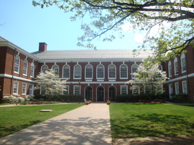

About
=====

Motivation
----------

Measurements at microwave frequencies can require a significant amount post-processing and analysis, especially in research and prototyping environments. From our experience, none of the existing software products satisfy the needs of these environments, in which the abilities to understand, modify, and extend existing functionality are vital. In an attempt to provide this needed functionality, we have created scikit-rf, an open source, BSD-licensed package for microwave engineering implemented in the Python programming language. scikit-rf seeks to provides a modern, object-oriented library for network analysis and calibration aimed at being flexible and scalable.

Development History
-------------------

**scikit-rf** was created in 2009 by Alex Arsenovic while he was a graduate student at the University of Virginia's millimeter wave research lab in 2009. It was originally called mwavepy, but was re-branded a scikit to emphasize its relationship to the scientific python community. **scikit-rf** is licensed under the :doc:`BSD License <license>` and is currently being actively developed by a group of volunteers `on Github <https://github.com/scikit-rf/scikit-rf/graphs/contributors>`_.
