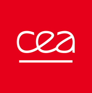
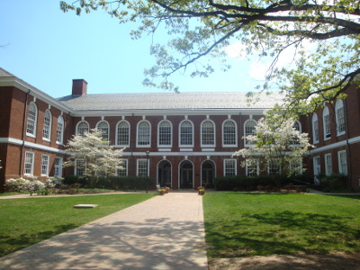
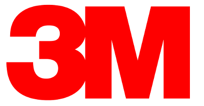
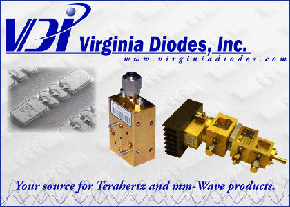
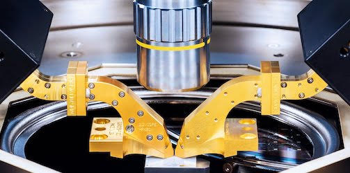

Users
=====

Below is a list of users of scikit-rf from industry and academia.

.. rst-class:: sk-users

CEA
---

https://www.cea.fr

The French Alternative Energies and Atomic Energy Commission or CEA (French: Commissariat à l'énergie atomique et aux énergies alternatives), is a French public government-funded research organisation in the areas of energy, defense and security, information technologies and health technologies. The CEA maintains a cross-disciplinary culture of engineers and researchers, building on the synergies between fundamental and technological research.

.. rst-class:: sk-users

UVa Terahertz Lab
-----------------

http://www.uvaterahertz.com/

UVa Terahertz Lab's mission is to create electronic devices capable of operating in the millimeter and sub-millimeter wave range. Our work includes high-frequency millimeter-wave power generation, low-noise receiver elements, integrated-circuit antennas and quasi-optical techniques.

.. rst-class:: sk-users

3M Company
----------

http://3m.com/

3M is a large manufacturing corporation. Although it is well known for consumer products such as Scotch™ Tape and Post-It™ Notes, 3M has over 30000 products for areas such as Health Care, Electronics, Industrial, etc. 3M Uses scikit-rf for the automation of data collection and and sophisticated analysis and calibration routines not available in the on-board analyzer software to perform a variety of material property characterizations.

.. rst-class:: sk-users

Virginia Diodes, Inc
--------------------

http://vadiodes.com/

VDI manufactures state-of-the-art test and measurement equipment for mm-wave and THz applications. These products include Vector Network Analyzer, Spectrum Analyzer and Signal Generator Extension Modules that extend the capability of high performance microwave measurement tools to higher frequencies. VDI's component products include detectors, mixers, frequency multipliers and custom systems for reliable operation at frequencies between 50 GHz and 2 THz. All VDI components include in-house fabricated GaAs Schottky diodes and microelectronic filter structures.

.. rst-class:: sk-users

Dominion MicroProbes, Inc
-------------------------

http://dmprobes.com/

DMPI designs, manufactures and sells millimeter and sub-millimeter wavelength on-wafer ground-signal-ground probes and associated components for electrical measurement of devices and materials. DMPI has developed a scalable approach for the manufacturing of phsyically robust micro machined probes with low-insertion loss coupling to the DUT and DC biasing of probed circuits.

.. rst-class:: sk-users

SweepMe!
--------

https://sweep-me.net/

SweepMe! is a multi-tool test & measurement software that allows to quickly combine instruments from different vendors using python programming language. The module 'NetworkAnalyzer' uses scikit-rf for exporting touchstone files. Starting from version 1.5.6, SweepMe! will be shipped with scikit-rf by default so that one can easily use the package in own python scripts that can be added to a measurement routine.

----

If your lab, company, or organization uses **scikit-rf** and would like to be listed please contact me at **alexanderarsenovic at gmail.com**
